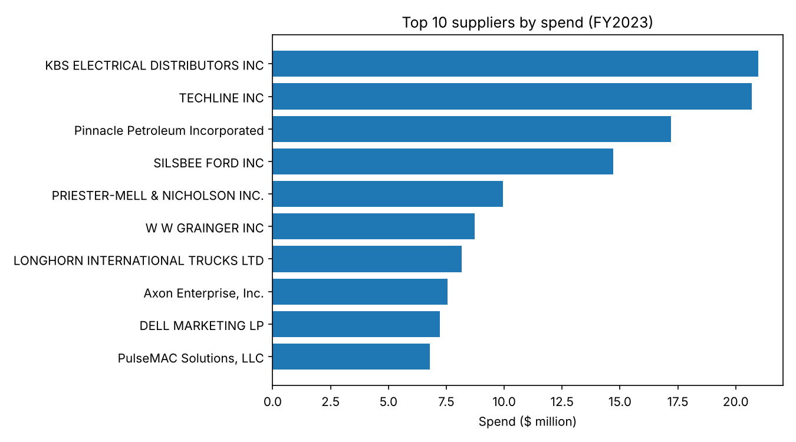
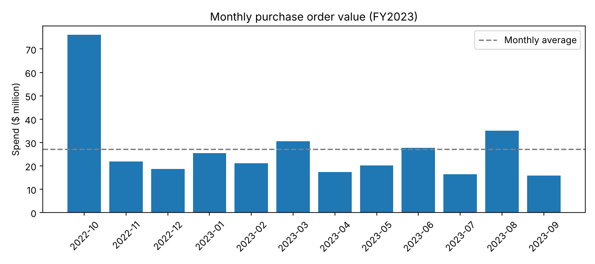

# City of Austin Procurement Analysis (Fiscal Year 2023)

A data analysis project that uses pandas to examine the goods purchases of the City of Austin (Texas, USA) in fiscal year 2023 and answer three business questions.

## Key findings

- **Spend is concentrated, but there is no dependence on a single supplier.** Of 916 suppliers, the top 10 receive 37.4% of spend. 80% of spend goes to 78 suppliers (8.5%).
- **There is no year-end spike; the spike is at the start of the year.** September is the lowest month. 23% of spend falls in October, driven by annual orders opened at the start of the fiscal year.
- **Master agreement coverage is high.** 93.2% of spend is tied to master agreements. What falls outside is mostly one-off large purchases such as helicopters and heavy machinery.

## Business questions

1. **Supplier concentration:** Is spend concentrated in a few suppliers?
2. **Timing:** How is spend distributed across the year? Is there a spike at fiscal year-end?
3. **Master agreement coverage:** How much of the spend is tied to master agreements?

## Data

| | |
|---|---|
| Source | City of Austin Open Data Portal: [Purchase Order Quantity Price detail for Commodity/Goods procurements](https://data.austintexas.gov/d/3ebq-e9iz) |
| Period | Fiscal year 2023 (1 October 2022 – 30 September 2023) |
| Size | 10,699 line items, 5,930 purchase orders, 916 suppliers |
| Total value | $326.3 million |
| Data version | Portal build of 2 November 2026 |

Each row is one line item of a purchase order: product code and description, quantity, unit price, line amount, related master agreement, award date and supplier.

To download the same data, open this link in a browser:

```
https://data.austintexas.gov/resource/3ebq-e9iz.csv?$where=award_date%20between%20'2022-10-01T00:00:00'%20and%20'2023-09-30T23:59:59'&$limit=20000
```

## Method

Data quality was checked before the analysis, which led to two decisions:

1. **Spend is measured with the `itm_tot_am` column.** About half of the rows have a quantity and unit price of 0 but a filled-in line amount. These appear to be orders placed by amount, and they make up 45% of total spend. Calculating spend as `quantity × unit price` would have lost it.
2. **Suppliers are grouped by `vendor_code`, not by name.** 14 supplier codes appear with more than one name (e.g. `H E B GROCERY CO L P` and `H-E-B, LP`). Grouping by name would have counted the same company as two suppliers.

The questions were answered with `groupby`, share and cumulative share calculations, extracting the month from the date column, and filtering. Charts were drawn with matplotlib.

## Findings

### 1. Supplier concentration



- The top 10 suppliers receive **37.4%** of total spend.
- **80% of spend goes to 78 suppliers**, only 8.5% of all suppliers.
- Even the largest supplier (KBS Electrical, electrical supplies) receives just 6.4% of the total.

A sensible focus for the procurement team is the 78 suppliers that make up 80% of spend.

### 2. Timing



- The expected year-end spike does not appear: **September** is the lowest month at $15.8M.
- The real spike is in the first month of the year: **October** accounts for 23% of the total at $76.0M, about 2.8 times the monthly average ($27.2M).
- October's largest line items are orders such as *Blanket DO for ProCard Purchases FY23*, opened at the start of the year to be used throughout the year. The 10 largest line items alone make up 36% of October.

This data shows when an **order** was placed, not when a payment was made. Testing for a year-end spending spike would require payment data.

### 3. Master agreement coverage

| | Line items | Value ($M) | Share |
|---|---|---|---|
| Tied to a master agreement | 8,492 | 304.0 | 93.2% |
| Not tied | 2,207 | 22.2 | 6.8% |

Line items not tied to an agreement make up 21% of rows but only 6.8% of spend. The largest are helicopters ($3.1M), industrial machinery ($2.7M) and quicklime ($2.4M).

## Limitations

- **Order date, not payment:** The data does not show when money was paid.
- **Not all of the city's procurement:** The dataset focuses on goods purchases.
- **One fiscal year:** Several years would need to be compared to see whether the October spike repeats every year.
- **Product-level price comparison is not possible:** The product code identifies a product group, not a single product. For the distribution transformer code, the unit price ranges from $459 (a refurbished 25 kVA pole-mounted transformer) to $229,425 (a 2000 kVA network transformer). See section 8 of the notebook for details.

## Junior DuckDB and REST API extension

[](https://github.com/dogantunagerguz/austin-procurement-analysis/actions/workflows/ci.yml)

The original pandas analysis now includes a small, runnable junior extension:

- a paginated City of Austin REST API downloader with retries and schema validation;
- DuckDB staging, supplier/month KPI views and four data-quality checks;
- three unit tests plus a GitHub Actions workflow.

[Read the junior extension guide](docs/junior-data-stack.md) · [REST API ingestion](scripts/download_data.py) · [DuckDB analysis](duckdb/run_analysis.py) · [Tests](tests/test_pipeline.py)

## Project structure

```
austin-procurement-analysis/
├── README.md
├── austin_procurement_fy2023.ipynb   # full analysis with explanations
├── requirements.txt
├── scripts/                    # REST API ingestion
├── duckdb/                    # local SQL/KPI checks
├── tests/                     # REST and DuckDB tests
├── data/
│   └── austin_purchase_orders_fy2023.csv
└── images/
    ├── top10_suppliers.png
    └── monthly_spend.png
```

## How to run

```bash
pip install -r requirements.txt
jupyter notebook austin_procurement_fy2023.ipynb
python duckdb/run_analysis.py
python -m unittest discover -s tests -v
```

Once the notebook is open, use *Run All* to run it from top to bottom. Charts are saved to the `images/` folder.

## Skills used

- **pandas:** `read_csv`, `info`, `isna`, `describe`, filtering, `groupby` + `agg`, `sort_values`, `cumsum`, `nlargest`, date conversion (`to_datetime`, `to_period`)
- **matplotlib:** horizontal and vertical bar charts, reference lines, saving figures
- **Data stack:** REST API ingestion, DuckDB SQL/KPI views, automated tests and GitHub Actions
- **Analytical thinking:** data quality checks, choosing the right grouping key, explaining a result that contradicts the expectation, recognising a question the data cannot answer
